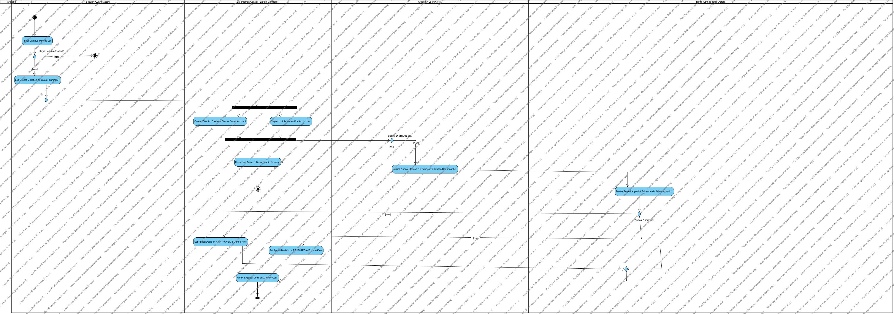
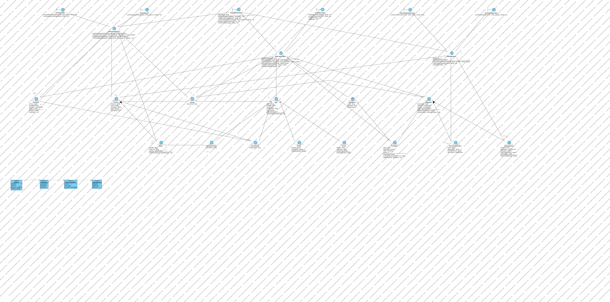
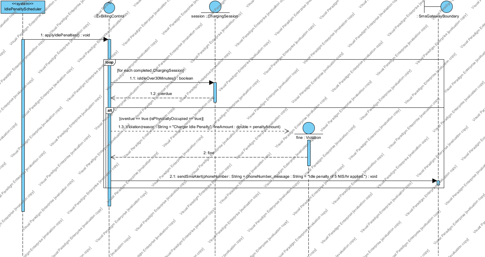
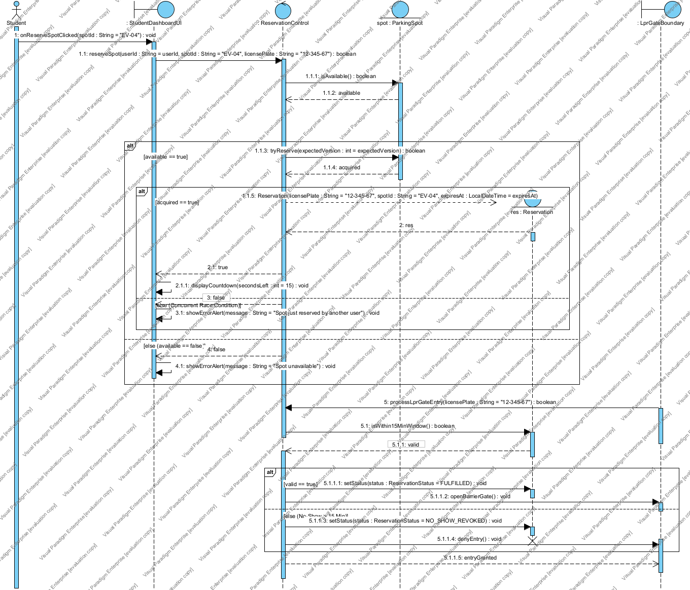

# System Architecture & Object-Oriented Design (`Ex4_SmartParking_Design`)

**Course:** 61756 Software Engineering Methods (Academic Year 2026-2027)
**Institution:** ORT Braude College of Engineering | Department of Software Engineering
**Domain:** Smart Campus Parking, LPR, and EV Network (continued from Exercise 1)

---

## 1. Engineering Team & Repository

| Role | Full Name | Student ID | Braude Academic Email |
| :--- | :--- | :--- | :--- |
| **Student A (Role A)** | `Yair Zaidsher` | `206019747` | `Yair.Zaidsher@e.braude.ac.il` |
| **Student B (Role B)** | `Dana Weiss` | `208103903` | `Dana.Weiss@e.braude.ac.il` |

* **Group Number:** `G[XX]`
* **GitHub Repository URL:** <https://github.com/YairZaid/Ex4_SmartParking_Design>
* **Visual Paradigm Model:** [`SystemModel_Ex4.vpp`](SystemModel_Ex4.vpp)
* **Domain Specification:** [`SYSTEM_STORY.md`](SYSTEM_STORY.md)

* **PNG'S of Diagrams: 
* 
* 
* 
* 
---

## 2. Step 1: Business Process Modeling — Activity Diagram

* **PlantUML Source:** [`diagrams/activity_appeal.puml`](diagrams/activity_appeal.puml)
* **Scope:** Severe violation logging, parallel fine attachment and user notification, and the Digital Appeal review workflow.
* **Partitions (swimlanes):** The external actors (`Security Guard`, `Student / User`, `Traffic Administrator`) are separated from the internal system controller (`EnforcementControl`).
* **UML elements used:** initial node, `fork` / `join` (AND) for the parallel fine attachment and notification, `decision` (XOR) with explicit `[guards]` for Approve / Reject, `merge` (OR), and an activity final node.


---

## 3. Step 2: Structural Modeling — ECB Class Diagram

* **PlantUML Source:** [`diagrams/class_diagram_ecb.puml`](diagrams/class_diagram_ecb.puml)
* **Pattern:** Entity-Control-Boundary (ECB). Boundary classes communicate **only** with control classes; entities are passive domain objects that hold persistent state.


### 3.1 ECB Component Responsibility Table

| Stereotype | Component | Responsibility |
| :--- | :--- | :--- |
| `<<boundary>>` | `StudentDashboardUI` | Student/Faculty interface: shows available spots for the user's allowed zones, sends reservation requests, displays the 15-minute countdown and error alerts, and submits Digital Appeals. |
| `<<boundary>>` | `GuardTerminalUI` | Security guard's mobile terminal: logs Severe Violations and issues Guest QR passes. |
| `<<boundary>>` | `AdminAppealUI` | Traffic Administrator interface for approving or rejecting Digital Appeals. |
| `<<boundary>>` | `LprGateBoundary` | Interface to the external LPR cameras and barrier gate: reports scanned plates and Guest QR codes, and opens the gate or denies entry. |
| `<<boundary>>` | `PaymentGatewayBoundary` | Interface to the external payment gateway for credit card authorization before EV charging. |
| `<<boundary>>` | `SmsGatewayBoundary` | Interface to the external SMS gateway for charge-complete and idle-penalty alerts. |
| `<<boundary>>` | `EvBaySensorBoundary` | Interface to the EV charger and bay occupancy sensors. Reports **cable unplugged** and **bay vacated** as two separate events. |
| `<<control>>` | `ReservationControl` | Zone-filtered spot discovery, atomic spot reservation (version check), LPR and Guest QR gate entry, and automatic 15-minute no-show revocation. |
| `<<control>>` | `EvBillingControl` | EV payment authorization, 100% charge notification, cable/bay state handling, and the single, growing Charger Idle Penalty. |
| `<<control>>` | `EnforcementControl` | Guest pass issuing, Severe Violation logging (fine attachment and notification in parallel), and the Digital Appeal workflow. |
| `<<entity>>` | `User` (`Student`, `Faculty`, `SecurityGuard`, `TrafficAdministrator`) | Identity, role, permit status, and the `noShowWarnings` counter. |
| `<<entity>>` | `Vehicle` | License plate, linking users to reservations and violations. |
| `<<entity>>` | `GuestPass` | Temporary QR token for a guest vehicle, with expiry and single-use flag. |
| `<<entity>>` | `ParkingZone` | Groups spots by zone (e.g. "Student Zone"). |
| `<<entity>>` | `ParkingSpot` | Spot status plus the `version` counter, with `getVersion()` and atomic `tryReserve(expectedVersion)`. |
| `<<entity>>` | `Reservation` | 15-minute reservation window and status (`ACTIVE`, `FULFILLED`, `NO_SHOW_REVOKED`). |
| `<<entity>>` | `PaymentAuthorization` | Result of the EV credit card authorization. |
| `<<entity>>` | `ChargingSession` | Keeps `isPluggedIn` and `isPhysicallyOccupied` separate, calculates the accrued idle penalty, and links to its single idle `Violation`. |
| `<<entity>>` | `Violation` | Severe Violation or Charger Idle Penalty, with a fine amount that can grow (`updateFineAmount`) or be cancelled. |
| `<<entity>>` | `Appeal` | Digital Appeal text and decision (`PENDING`, `APPROVED`, `REJECTED`). |
| `<<enum>>` | `UserRole`, `SpotStatus`, `ReservationStatus`, `AppealDecision` | Fixed value sets used by the entities above. |

Timer participants in the sequence diagrams (`:NoShowScheduler`, `:IdlePenaltyScheduler`) are `<<system>>` clock triggers. They are not domain classes, so they do not appear in the class diagram.

---

## 4. Step 3: Behavioral Modeling — ECB Sequence Diagrams

### 4.1 Sequence Diagram 1: Spot Reservation, LPR Gate Entry & No-Show Revocation
* **PlantUML Source:** [`diagrams/sequence_reservation_ecb.puml`](diagrams/sequence_reservation_ecb.puml)
* **Flow:**
  1. `ReservationControl` reads the spot's `version`, checks availability, and calls `tryReserve(expectedVersion)`. A `Reservation` is created only if that call succeeds; otherwise the user sees "Spot just reserved by another user".
  2. An `alt` fragment then covers both outcomes:
     * **Vehicle detected within 15 minutes:** the reservation becomes `FULFILLED`, the spot becomes `OCCUPIED`, and the gate opens.
     * **No vehicle within 15 minutes:** the scheduler calls `revokeExpiredReservations()`. The reservation becomes `NO_SHOW_REVOKED`, the spot returns to `AVAILABLE`, the user's `noShowWarnings` is incremented, and the reservation is destroyed.


### 4.2 Sequence Diagram 2: EV Charging 30-Minute Idle Penalty
* **PlantUML Source:** [`diagrams/sequence_idle_penalty_ecb.puml`](diagrams/sequence_idle_penalty_ecb.puml)
* **Flow:** the diagram has three stages.
  1. **Minute 29:** the driver unplugs the cable. `markCableUnplugged()` sets only `isPluggedIn = false`; the car is still in the bay.
  2. **Minute 30 and later:** the scheduler loops over completed sessions. If `isIdleOver30Minutes()` is true, `EvBillingControl` calculates the accrued amount. It then either creates the session's single idle `Violation` (and sends the SMS once) or updates the existing violation's amount.
  3. **Bay vacated:** `markBayVacated()` clears `isPhysicallyOccupied`, and the penalty stops growing.


---

## 5. Part 4: Independent AI Design Critique


### 5.1 Verbatim AI Critique Prompts

**Prompt 1 — edge-case audit:**

```text
please, explore the puml files iv'e attached,check for those 2 specific edge cases that appear in system_story.md file, once you find the problematic edge cases in the files, audit those files to fix those problems (solve only the parts that responsible on the edge cases) . the edge cases: *  Edge Case A (Double-Booking Race Condition): Two students simultaneously click Reserve on the last available spot in Student Zone at the exact same millisecond.
*  Edge Case B (Physical vs. Electrical EV State): An EV driver unplugs the charging cable at minute 29 without physically moving the car out of the EV bay.
```

**Prompt 2 — verification and additional improvement:**

```text
Verify that the  Class and Sequence diagrams properly model version/tryReserve() and separate isPluggedIn from isPhysicallyOccupied, and apply at least one additional improvement ( write me what is the improvment you did)
```

**Prompt 3 — idle penalty refinement:**

```text
fix the idle penalty to one growing violation
```

### 5.2 Applied Improvements

1. **Edge Case A — Double-booking race condition.**
   * *Problem:* The sequence diagram called `tryReserve(expectedVersion)`, but nothing ever supplied `expectedVersion`, and `ParkingSpot` exposed no way to read its version.
   * *Fix:* Added `getVersion() : int` to `ParkingSpot`. The reservation flow now reads the version, then calls `tryReserve(expectedVersion)`, which is documented as an atomic compare-and-set. It succeeds only if the status is `AVAILABLE` and the version matches, then sets `RESERVED` and increments the version. When two students try to reserve the last spot in the same millisecond, exactly one succeeds; the other follows the `acquired == false` branch.

2. **Edge Case B — Physical vs. electrical EV state.**
   * *Problem:* `ChargingSession` had separate `isPluggedIn` and `isPhysicallyOccupied` fields, but nothing could change them independently, and no boundary reported either event. The idle-penalty sequence diagram did not model the unplug at all.
   * *Fix:*
     * Added `EvBaySensorBoundary` (`onCableUnplugged`, `onBayVacated`).
     * Added `EvBillingControl.handleCableUnplugged` / `handleBayVacated`.
     * Added `ChargingSession.markCableUnplugged()` / `markBayVacated()`.
     * Documented `isIdleOver30Minutes()` as depending only on `isPhysicallyOccupied`.
     * The sequence diagram now shows the unplug at minute 29, the penalty still applying, and the penalty stopping only when the bay is vacated.

3. **Additional improvement — automatic no-show revocation.**
   * *Problem:* A reservation was revoked only if the car eventually reached the gate late. If the car never arrived, the spot stayed `RESERVED` forever, `noShowWarnings` was never incremented, and on a successful entry the spot was never set to `OCCUPIED`.
   * *Fix:* Added a timer-driven `revokeExpiredReservations()` branch. It revokes the reservation, releases the spot to `AVAILABLE`, and increments `noShowWarnings`. The arrival branch now sets the spot to `OCCUPIED`.

4. **Additional improvement — a single, growing Charger Idle Penalty.**
   * *Problem:* Every scheduler run created a new `Violation` and sent a new SMS.
   * *Fix:*
     * Added the association `ChargingSession "1" -- "0..1" Violation`.
     * Added `calculateIdlePenalty`, `getIdleViolation` and `attachIdleViolation` to `ChargingSession`, and `updateFineAmount` to `Violation`.
     * The penalty is now created once on the first overdue check, with one SMS. On later checks its amount is updated to 5 NIS per started idle hour, until the bay is vacated.

---

## 6. License
Distributed under the **ORT Braude College Academic License** (61756 Software Engineering Methods, 2026-2027).
